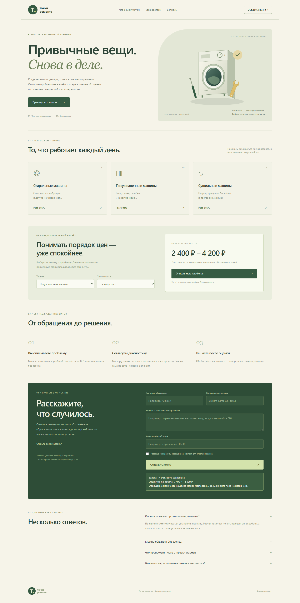

# Точка ремонта — сайт мастерской

Pet-проект для портфолио. Мастерская и цены вымышлены. Сайт показывает услуги, предварительный расчёт и сохраняет обращения на доску заявок.



## Сценарий

Откройте http://127.0.0.1:8767 после запуска. Выберите технику и проблему, проверьте расчёт, отправьте обращение и перейдите на доску заявок. Переведите карточку в работу — статус сохранится после обновления страницы и перезапуска сервера.

## Возможности

- Адаптивный сайт услуг с собственной SVG-иллюстрацией, этапами работы и раскрывающимися вопросами.
- Калькулятор с одним набором правил на сервере. Подмена цены в браузере не меняет сохранённую оценку.
- Проверка контакта, длины описания и подтверждения сохранения обращения.
- SQLite и статусы «Новая / В работе / Завершена», фильтр на доске.
- Повторная и конкурентная отправка одного запроса возвращает тот же номер. При изменении данных с прежним ключом сервер сообщает об ошибке.

## Структура

```text
app.py                 маршруты API
engine.py              расчёт, валидация и SQLite
local_server.py        локальный сервер
web/index.html         публичная часть
web/admin.html         доска заявок
tests/                 проверки расчёта, ввода и сохранения
```

Расчёт — диапазон стоимости работы без запчастей; он не бронирует визит. Форма сохраняется в локальную базу; уведомления во внешние сервисы не подключены. Доска `/admin.html` доступна без авторизации в пределах локального сервера.

## Разработка

Требуется Python 3.10+. Сторонних зависимостей для запуска нет.

```text
python app.py
python -m unittest discover -s tests -v
```

На Windows можно запустить `START.cmd` или использовать `py -3` вместо `python`. Остановка сервера — Ctrl+C. Для другого порта: `python app.py --port 8780`.

HTTP-сервер слушает только `127.0.0.1`. Приложение рассчитано на локальный запуск.

В `.github/workflows/tests.yml` настроен запуск тестов на Python 3.10 и 3.12. Результаты локальных проверок — в [TESTING.md](TESTING.md).

Лицензия MIT.
